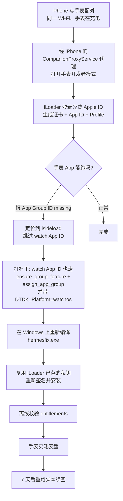
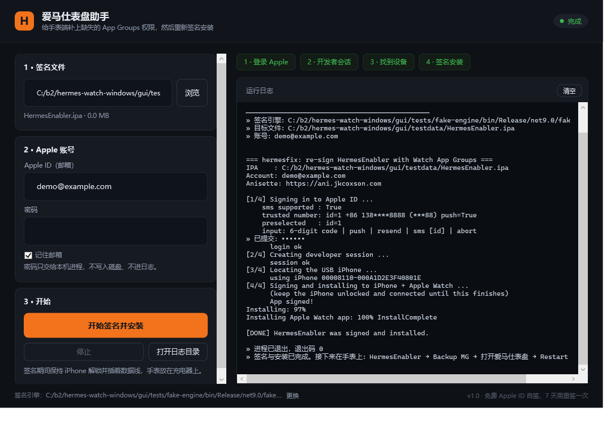

# HermesEnabler · Watch App App Groups 修复

> 在 **Windows** 上，只用 **免费 Apple ID**，把爱马仕（Hermès）原生表盘装到 Apple Watch。
> 本仓库解决的是这条路上最后一个、也是最容易被误判的坎：**手表端 App Group 权限缺失**。

> **只想装上手表？看 [docs/05-使用教程.md](docs/05-使用教程.md)。**
> 从下载 exe 到手表生效，12 步，每步都有「怎么判断成功了」，不装 Rust、不碰命令行、不需要 iLoader。
>
> **想从零构建 / 搞懂原理？看 [docs/00-从零开始.md](docs/00-从零开始.md)。**
> 六阶段顺序教程，每步都有「判据」与失败处理，也包含给 AI Agent 的分阶段指令模板。
> 本 README 只讲结论和原理。

---

## 结论先行

| 问题 | 答案 |
| --- | --- |
| 免费 Apple ID 能不能用 App Groups？ | **能。** 免费个人团队同样可以创建 `group.*` 并分配给 App ID，无需付费账号 |
| 为什么 iPhone 装好了、手表却报 *An App Group ID may be missing*？ | **不是账号权限问题，是工具 bug。** isideload 在遍历 App ID 时对 watchOS 的 App ID 直接 `continue`，导致手表 App ID 既没开通 `APG3427HIY` 能力位，也没被分配 App Group |
| 需要重装 iOS、重置配对、越狱吗？ | **都不需要。** 只重签 IPA 即可 |
| 怎么证明修好了？ | 解包签名后的 IPA，watch 的 `embedded.mobileprovision` 与 watch 二进制内嵌 entitlements 里都出现 `com.apple.security.application-groups` |

一句话：**改一行 `continue`，重签一次，手表就有了 Group 容器。**

---

## 整体思路



关键认知有三条：

1. **entitlements 不是 App 自带的，是 Profile 带下来的。**
   签名工具能做的只有"按 Profile 里的 entitlements 写进二进制"。所以 App Group 必须在 **Apple 侧**先分配好，Profile 里才会出现，本地才有东西可写。

2. **watchOS App 是独立 App ID。**
   它有自己的 bundle id（`...watchkitapp`）、自己的 Profile、自己的 entitlements。iPhone 端修好 ≠ 手表端修好。Apple 的 Developer API 还要求请求体带上 `DTDK_Platform=watchos`，否则解析不到这个 App ID。

3. **免费账号的限制是"7 天 + 3 张证书"，不是"没有 App Groups"。**
   所以整条链路上不需要花钱，只需要每 7 天重签一次。

---

## 下载

去 **[Releases](https://github.com/YEZH0/hermes-watch-windows/releases)** 挑一个：

| 文件 | 大小 | 需要装 .NET 吗 |
| --- | --- | --- |
| **HermesFixGui-standalone.exe** | 69 MB | **不需要**，双击就跑 |
| HermesFixGui.exe | 28 MB | 需要 .NET 9 桌面运行时（x64） |

不确定就下第一个。自包含、免安装、不写注册表、不要管理员权限。

当前版本 **v1.5.1**：

```
SHA-256（standalone）: 440d53c88b45b4f2d1866e29ed01c8cfa680b76af3ccd49968f3e1e3c8e6b811
SHA-256（28 MB）    : d3f56c7889929b5da273760e3edd589beac9e6810daf27d5d6729cd98d609cb4
```

> 或者自己编：`dotnet build gui/HermesFix.csproj -c Release`，零第三方 NuGet 依赖。
> 引擎 `bin/hermesfix.exe` 会被作为资源嵌进去。要出单文件包跑 `scripts\build-gui.cmd`。
> 仓库里的 `bin/HermesFixGui.exe` 就是上面那个 28 MB 的 1.5.1 包。

> **1.5.1 修的是「第一道门」：电脑、iPhone、手表之间的信任关系。**
>
> 1.5.0 会去问手表开发者模式开没开，但整条链路默认「这台电脑已经和 iPhone 配过对」。
> 现实里第一次用的人根本没配过——于是卡死在一句「拿不到 iPhone 的配对记录」，
> 既没告诉用户去手机上点「信任」，也没法接着问手表。这一版把两道信任门都补上了：
>
> | 门 | 什么时候会出现 | 软件现在怎么做 |
> | --- | --- | --- |
> | iPhone 信任这台电脑 | 第一次插线、换电脑、换手机、在手机上点过「不信任」 | **主动发一次配对请求**，iPhone 上弹出「要信任此电脑吗」，点「信任」即可 |
> | 手表信任这台电脑 | 第一次连手表、手表还原过、换电脑 | 手表上会弹「信任这台电脑」，点「信任」；**成功后记录存本地，下次不再打扰手表** |
>
> - 命令：`hermesfix.exe --pair-phone` 可以单独把「请信任这台电脑」问出来，不用跑整个流程。
> - 建会话前先问 iPhone「你认得哪几台手表」（companion registry），一台都没有时不再瞎试。
> - 手表这边按三步走：**本地缓存的配对记录 → 复用这台电脑已有的身份 → 真正配对一次**。
>   第二步能覆盖「以前用 iLoader 装过 App」的情况——那种情况下手表早就信任这台电脑了，
>   根本不需要再弹框。
> - 配对记录存在 `%LOCALAPPDATA%\HermesWatch\pairing\`（`phone-<UDID>.plist` /
>   `watch-<手表ID>.plist` + 固定的 `host-id.txt`），用 icacls 收到当前用户，
>   **不进日志、不上传**。删掉这个目录等于「忘记这台电脑」，下次会重新问一遍。
> - 引擎版本 **1.5.1**（`hermesfix.exe` 的 SHA-256 是 `aa6cd9eb`）。
>
> **同一版里还修了「一直连不上手表」的真正原因。** 之前每次检测都停在
> `device socket io failed`，看起来像手表没连上，其实是两处连接用法错了：
>
> | 错在哪 | 后果 | 现在 |
> | --- | --- | --- |
> | iPhone 的 `companion_proxy` **一条连接只答一条命令**，我们却在同一条连接上连发三条 | 第二条就断，真正要用的「转发手表 lockdown 端口」永远发不出去 | 每条命令一条新连接（和 iLoader 一致） |
> | 转发出来的端口**一次只服一条连接**，卡住的那条会把端口堵死 | 后一条能握手、写不进数据 | 每次尝试重新转发，不重复用旧端口 |
>
> 顺带把「手表没回话」和「手表不认这台电脑」分开了：只有 `InvalidHostID` 才会去
> 弹「信任」；一句都没答就直说是 iPhone 到手表这一段没通，并给出该做的三件事。
> 手表刚被蓝牙唤醒时第一个请求经常丢，所以静默的情况会自动换条转发再问一次。
>
> 另外修了两处会让人误判的文案：手表锁着却提示「戴在手上、放充电器上」的语病改成
> 「保持 iPhone 和手表解锁」；转发端口失败时不再甩 `device socket io failed`，
> 而是直接说「iPhone 送不到手表，确认手表和 iPhone 蓝牙连着」。

> **1.5.0（历史）：在签名之前先问手表一句：开发者模式到底开了没有。**
>
> 以前这一项只能靠猜：自检里写「需人工」，真正的判断要等签名跑完、手表阶段失败才知道。
> 现在软件会走和安装完全相同的链路（USB iPhone → companion proxy → 手表 lockdown），
> 再打开手表上的 `com.apple.amfi.lockdown` 服务问一次，拿到三种结论之一：
>
> | 结论 | 含义 | 软件怎么做 |
> | --- | --- | --- |
> | 已开启 | 手表回 `developer_mode = true` | 放行，照原流程签名安装 |
> | 未开启 | 手表回 `developer_mode = false` | **拦住开始按钮**，给出在手表上打开的具体路径 |
> | 无法确认 | 手表锁着 / 连不上 / 服务问不出来 | **不假装通过**，说明原因并引导重新检测 |
>
> - 「手表锁着」和「开发者模式没开」是两件事，分开提示：前者让你去解锁，后者让你去翻设置。
> - 界面上多了一个 **「显示开发者模式入口」**：请求手表把「设置 → 隐私与安全性 → 开发者模式」
>   这一项显示出来（AMFI `action 0`）。**入口显示出来不等于已经开启**，开关、密码、重启都得你自己做，
>   完成后点「重新检测」才算数。
> - 没确认开启时，点「开始签名并安装」会被挡住——省下十几分钟，也省下免费账号的一次证书额度。
> - 这一套只读，不 enable、不重启、不 unpair、不删信任、不改系统设置；判定逻辑在
>   `hermesfix/src/devmode.rs`，界面在 `gui/DevModeCheck.cs`。
>
> **第一阶段的提示词一个字没改，仍然可以单独用。** `docs/00-从零开始.md` 阶段 1 那套
> 「在手表上打开开发者模式」的手动流程照旧有效；软件里这一套是给「忘了做 / 不确定做没做」的人兜底的，
> 两者不冲突，也不互相替代。
>
> 引擎版本 1.5.0（`hermesfix.exe` 的 SHA-256 是 `a4c7ad7d`）。登录、证书、App Groups、
> IPA 签名与 Watch 安装的核心逻辑一行未改。

> **1.4.0（历史）：重写了「手表那步失败」这件事——先告诉你是谁的问题，再让你只重跑那一段。**
>
> 以前手表连不上时，引擎只会吐一句 `Failed to pair with the Apple Watch through companion
> proxy`，界面再翻译成「iPhone 未解锁 / 数据线松了 / 密码错」——明明是最常见的**手表锁屏**，
> 却让人去查 Apple ID。现在：
>
> - 引擎按**错误类型**分类（`IdeviceError::PasswordProtected`、`PairingDialogResponsePending`、
>   `UserDeniedPairing`、`IXErrorDomain Code=48`…），不再靠字符串猜；每条失败发一行
>   `@@HF_EVENT@@` JSON，带 `stage / code / title / action / recoverable / retry`。
> - 进度从 4 段拆成 **5 段**：登录 → 签名 → iPhone 安装 → **Watch 连接** → **Watch 安装**。
>   装之前先探测手表，锁屏两秒内就能给结论，不用等十几分钟再看一句含糊的失败。
> - 失败卡片给稳定错误码 + 能照着做的动作（16 种，见
>   [教程 §8.1](docs/05-使用教程.md)），并按错误码决定提示什么，**不会再把 Watch 问题说成密码错**。
> - 签名产物会缓存到 `%LOCALAPPDATA%\HermesWatch\signed\<id>`（只授当前用户，无密码/验证码/Token），
>   手表解锁后点「继续安装到手表」**只重跑第 4、5 段**——不重新登录、不重新申请证书、不重装 iPhone。
>   复用前重新校验整棵树的哈希和 profile 到期时间，并核对还是不是签名时那两台设备。
> - 签名产物在交给设备之前先做离线自检（profile 与 bundle 是否对应、设备是否在
>   `ProvisionedDevices` 里、watch 的 entitlements 是否真带 App Group），把「无法验证 App 完整性」
>   这种设备端含糊报错提前挡在本地。
>
> 引擎版本升到 1.4.0（`hermesfix.exe` 的 SHA-256 从 `700444d3` 变成 `c2abb754`）。
> **登录、证书复用、App Group、签名这几条核心路径一行未改**，`iloader-main/vendor/` 与
> `apple-codesign/` 完全没动；改的是错误传播、手表探测、缓存续装与界面。

> **1.4.0 没有用真实 Apple ID 重跑真机安装。** 所有验证都在模拟引擎上完成（锁屏、连不上、
> 协调器冲突、iPhone 锁屏、续装全流程），**真机上的手表锁屏路径仍需你实测**。真机完整跑通过的
> 仍是 1.3.1 / 1.5.1 那一组。

> **1.3.1（历史版本）：** 修了两个界面缺陷，并把仓库里的 IPA 换成上游最新的 1.5.4。
> 一是两步验证码**输入框太矮**：`Height=34` 配上样式里上下各 8 的 `Padding`，内容区只剩 16 px，
> 15 号字整行被裁掉，打进去的验证码一个字都看不见（功能其实一直是好的，回车能提交）。
> 二是底栏版本号硬编码在 `v1.2`，现在从程序集读。
> 三是 `ipa/HermesEnabler.ipa` 从 1.5.1 升到 **1.5.4**，自检的指纹与版本一并跟上——以前这份 IPA
> 被 `.gitignore` 挡着没入库，别人只能自己去上游下，容易下错版本。
> 1.3.1 的引擎与 1.2.0 / 1.3.0 逐字节相同（`700444d3`）；**1.4.0 换成了 `c2abb754`**。

> **1.3.0 与 1.3.1 都没有用真实 Apple ID 重跑真机签名。** 引擎二进制与 1.2.0 逐字节相同（`700444d3`），
> 登录、证书、App Groups、签名、安装这条链一行未改，改的全是界面与外设逻辑。要回退就下 v1.2.0。

> **工具和 IPA 是两个东西。** exe 是签名工具，**不含**表盘；`HermesEnabler.ipa` 才是装到手表上的
> 应用。两者版本号不需要对齐。仓库 `ipa/HermesEnabler.ipa` 带的是上游原版 **1.5.4**（未改一字节，
> 自检认的就是它）；真机完整跑通过的是 **1.5.1**，1.5.4 与它只差内容更新——bundle id、可执行名、
> fat 架构、Info.plist 结构全都没变，签名路径一致，但没重新做真机验证。上游再发新版，自检会提示
> 「上游已发布 X，仓库里附带的是 1.5.4」，那是提醒，不是阻止。

---

## 快速使用

两种方式**前置条件相同**：iPhone 用数据线连电脑并已信任；手表与 iPhone 已配对、同一 Wi-Fi；
手表已开启开发者模式（阶段 1）。

> 证书：引擎会**复用** iLoader 留在 Windows 凭据管理器里的私钥与证书；找不到也会**自己申请**一张
> （免费账号共 3 张额度）。所以 iLoader 不是必须的——但先跑过一次能省额度。

### 方式一：图形界面（推荐）



`HermesFixGui-standalone.exe` 是**单个文件**，签名引擎和要签的 `HermesEnabler.ipa` 都在里面
（首次启动释放到 `%LOCALAPPDATA%\HermesWatch`，都带 SHA-256 校验）。三步：

1. **不用管 `HermesEnabler.ipa`** —— 程序自带，启动时自己放好并填进「1 · 签名文件」，绿字写着「程序自带 · 已就绪」
2. 填 Apple ID 与密码
3. 点「开始签名并安装」

密码只通过子进程环境变量传递，不写磁盘、不进日志；两步验证码只在内存里回传，日志里显示为 `••••••`。
验证码默认**推送到受信任设备**（不是短信），收不到就点「再推送」，要用短信点「短信」——
如果引擎报上了受信任号码列表，下面会多出「改发短信到」一行，点哪个号码就走哪个号的短信通道，
只显示尾号，完整号码不进日志。

要反馈问题，用底部的「**导出日志**」。它在写入时就把完整手机号、Apple ID 邮箱、设备 UDID、
路径里的用户名换成了掩码，保留阶段标记、错误码和进度——够排错，不够用来定位到你。
这是尽力而为的脱敏而非保密承诺，发出去之前仍建议自己扫一眼；软件本身不会上传任何地方。

启动时会自动跑一次**环境自检**（底部「环境自检」可重新打开）：运行环境、签名引擎、IPA 指纹、
iPhone 连接服务、Anisette 服务、上游 HermesEnabler 的最新版本（只在打开自检时联网查一次，断网就跳过），
以及**手表开发者模式的实测结论**（已开启 / 未开启 / 无法确认，带原因）。判不了的项不会假装通过。

界面上方五个进度块对应引擎的五个阶段，状态栏会显示当前卡在哪一步。中途可以「停止」（会连子进程一起结束）。

- 两个版本功能一样：`standalone`（69 MB）自带运行时，`HermesFixGui.exe`（28 MB）需要
  **.NET 9 桌面运行时**（约 55 MB，一次装好）。要自己产 standalone，跑 `scripts\build-gui.cmd`
  最后一条命令
- 源码在 `gui/`，`dotnet build` 即可，**零第三方 NuGet 依赖**

### 方式二：命令行

```powershell
# 1. 把 HermesEnabler.ipa 放到仓库根目录（或用 -Ipa 指定路径）
# 2. 运行（双击 run-hermesfix.cmd 也可以）
.\run-hermesfix.cmd

# 3. 校验（对签名后的 IPA）
python .\scripts\verify_appgroup.py .\HermesEnabler.ipa
```

> 直接右键运行 `.ps1` 会报「禁止运行脚本」——这是 Windows 默认执行策略。
> `.cmd` 入口已带 `-ExecutionPolicy Bypass`，不影响系统设置。

`run-hermesfix.ps1` 会做三件事：核对 Apple ID 是否命中已存私钥、掩码读密码只经环境变量传递、提示两步验证的真实行为（**Apple 默认发推送，不发短信**）。

---

## 从源码重建（可选）

产物 `bin\hermesfix.exe` 已可直接使用。需要重建时：

```bash
bash scripts/build-windows-gnu.sh
```

脚本对本机踩过的坑做了处理，详见 [docs/02-构建.md](docs/02-构建.md)。三个硬性要求：

- `rustc` 所在路径必须是**纯 ASCII**（中文用户名会让 binutils 把路径编码成 `C:\Users\Ò¶Ö¾ºê` 而失败）
- 需要 `x86_64-pc-windows-gnu` 目标 + MinGW-w64 工具链（`gcc` / `ar` / `dlltool`）
- `ring` 的 build.rs 会把 nasm 路径硬编码成 `<target>/tools/windows/nasm/nasm`

---

## 验证

```powershell
python .\scripts\verify_appgroup.py <签名后的.ipa>
```

期望输出 4 项全 OK：

```
[watch profile]  ... com.apple.security.application-groups = ['group.com.example.HermesEnabler.<TEAMID>']  -> OK
[iphone profile] ... -> OK
[iphone binary]  ... -> OK
[watch binary]   ... -> OK
```

这是**离线铁证**：不依赖设备在线，只证明"签名产物里确实带了这个权限"。
设备侧是否真的生效，还要在手表上打开 HermesEnabler 看是否仍报 App Group 错误。

---

## 7 天续签

免费账号的 Profile 有效期是 7 天（本机实测签发于 11-12，到期 11-19 09:39）。

到期后**只需要**：

```powershell
.\scripts\run-hermesfix.ps1
```

⚠️ 不要在 iLoader 里"撤销证书 / 删除 App / 清除数据"——那会消耗免费账号仅有的 3 张证书额度，并可能让手表端需要重新配对安装。

---

## 给别人用：能分享的是工具，不是成品

**签好的 IPA 不能分享。** 签名会把「你的证书 + 你的 Provisioning Profile」嵌进包里，
而 iOS 安装时会校验 App ID ↔ 证书 ↔ 设备 UDID 三者一致。别人的手机/手表不在你的设备列表里，
装不上；即使装上，7 天后也会随 Profile 过期而崩。

所以正确的分享方式是：**发这个仓库，每个人用自己的 Apple ID 重签一次。**

对方需要满足：

| 条件 | 说明 |
| --- | --- |
| Windows x64 | 目前只有 GNU 工具链产物 |
| iPhone + Watch 已配对 | 手表能进开发者模式是前提 |
| 自己的免费 Apple ID | 各消耗自己的 3 张证书额度，互不影响 |
| 用仓库里的 HermesEnabler.ipa | 上游原版 1.5.4，一个字节没改；也可以自己去上游下 |
| 人工完成 2FA | 6 位码只推送到受信任设备，无法无人值守 |
| 人工开启手表开发者模式 | 软件能检测、也能把设置入口调出来，但开关、密码和重启必须人在手表上做 |

**不需要 iLoader。** 引擎自己就能申请证书（见下）。

最省事的方式——把 `bin/HermesFixGui.exe` 发给对方，照 [docs/05-使用教程.md](docs/05-使用教程.md) 做：

```
1. 装 .NET 9 桌面运行时（x64 Desktop，不是 ASP.NET）
2. 双击 HermesFixGui.exe        ← 引擎已内嵌，无需任何依赖
3. 拖入 HermesEnabler.ipa → 填自己的 Apple ID → 开始
```

想走命令行：

```powershell
git clone https://github.com/YEZH0/hermes-watch-windows
cd hermes-watch-windows
# 把 HermesEnabler.ipa 放进根目录
.\run-hermesfix.cmd
python .\scripts\verify_appgroup.py .\HermesEnabler.ipa
```

> **安全提示**：`bin\hermesfix.exe` 是预编译产物，运行时需要你的 Apple ID 密码。
> 不放心就自己编——`bash scripts/build-windows-gnu.sh` 的输入只有本仓库源码。
> 下载他人提供的 exe 前请比对 `SHA256SUMS.txt`。

## 许可

- 本仓库自有代码（`hermesfix/`、`scripts/`、`docs/`）：MIT
- `iloader-main/vendor/isideload/`：MIT，© Nicholas Sharp
- `apple-codesign/`：源自 [nab138/apple-crates](https://github.com/nab138/apple-crates)，遵循其上游许可

详见 [NOTICE.md](NOTICE.md)。

## 目录结构

```
.
├─ run-hermesfix.cmd           # 命令行入口（绕过执行策略）
├─ gui/                        # WPF 界面：选 IPA → 填账号 → 看进度和日志
│  ├─ MainWindow.xaml          # 界面与样式
│  ├─ MainWindow.xaml.cs       # 引擎进程封装 / 输出解析 / 2FA 回传
│  ├─ Demo.cs                  # 无头自测钩子（HF_DEMO）
│  └─ tests/fake-engine/       # 测试替身：不用真机也能验证整条链路
├─ hermesfix/                  # CLI：登录 → 签 App → 安装
│  ├─ Cargo.toml
│  ├─ Cargo.lock               # 无 git 源，可 --offline 复现
│  └─ src/main.rs
├─ iloader-main/vendor/isideload/   # 打了补丁的 isideload
├─ apple-codesign/             # 签名后端（nab138/apple-crates 的 apple-codesign）
├─ patches/
│  └─ 0001-isideload-watch-appgroup.patch   # 唯一的逻辑改动
├─ scripts/
│  ├─ run-hermesfix.ps1        # 交互式启动器（掩码密码 / 2FA 提示）
│  ├─ build-windows-gnu.sh     # 可复现构建
│  └─ verify_appgroup.py       # 离线校验 entitlements
├─ bin/
│  ├─ HermesFixGui.exe         # 图形界面（单文件，引擎已内嵌）
│  └─ hermesfix.exe            # 签名引擎（构建时会被内嵌进上面那个）
├─ NOTICE.md                   # 第三方组件与许可
└─ docs/
   ├─ 05-使用教程.md            # ★ 只想用：下载 → 装上手表，12 步
   ├─ 00-从零开始.md            # ★ 想构建：六阶段 + 判据 + 失败处理
   ├─ 01-原理.md
   ├─ 02-构建.md
   ├─ 03-踩坑记录.md
   └─ 04-验证与续签.md
```

---

## 已知限制

- **只在 Windows x64 + 免费个人团队 + watchOS 27 上实测通过。** 付费团队理论上同样适用，但未验证。
- **重签不会解决"账号被风控"类错误**（`-80045` / `-45061`）。那类问题出在 anisette 数据与 client-info 来源不一致，与本补丁无关。
- **两步验证的边界在 Apple 手里。** 验证码只会推到你账号的**受信任设备**——不一定是连着电脑的那台
  iPhone，也可能是另一台 iPhone、iPad 或 Mac。「再推送」「短信」只是向 Apple 发请求，
  **点了不等于一定送达**；账号被限流时越点越糟。详见 [docs/05-使用教程.md](docs/05-使用教程.md#7-开始然后等-6-位码)。
- **anisette 走公共实例 `ani.jkcoxson.com`。** 该实例偶尔不稳定，失败重试即可。
- 仓库里的 `ipa/HermesEnabler.ipa` 是上游原版（1.5.4），哈希见 `ipa/SHA256.txt`。**但不要**把**签名后**的 IPA 公开上传——里面的 provisioning profile 含你的 Team ID 与证书。
- **这是非官方工具。** 它不在 Apple 的授权范围内，走的是 Apple 公开接口的第三方实现。签名行为受开发者
  协议约束，修改系统表盘属于非官方用途。账号风险、设备风险、7 天过期，都得自己承担。别用它签你不拥有的
  Apple ID。

## 免责声明

仅供个人学习与自用设备。签名行为受 Apple 开发者协议约束；修改系统表盘属于非官方用途，风险自负。
