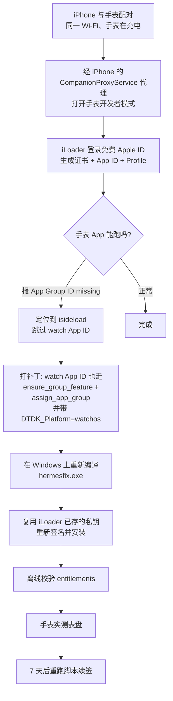

# HermesEnabler · Watch App App Groups 修复

> 在 **Windows** 上，只用 **免费 Apple ID**，把爱马仕（Hermès）原生表盘装到 Apple Watch。
> 本仓库解决的是这条路上最后一个、也是最容易被误判的坎：**手表端 App Group 权限缺失**。

> **只想装上手表？看 [docs/05-使用教程.md](docs/05-使用教程.md)。**
> 从下载 exe 到手表生效，12 步，每步都有「怎么判断成功了」，不装 Rust、不碰命令行、不需要 iLoader。
>
> **想从零构建 / 搞懂原理？看 [docs/00-从零开始.md](docs/00-从零开始.md)。**
> 六阶段顺序教程，每步都有「判据」与失败处理，也包含给 AI Agent 的分阶段指令模板。
> 本 README 只讲结论和原理。

---

## 结论先行

| 问题 | 答案 |
| --- | --- |
| 免费 Apple ID 能不能用 App Groups？ | **能。** 免费个人团队同样可以创建 `group.*` 并分配给 App ID，无需付费账号 |
| 为什么 iPhone 装好了、手表却报 *An App Group ID may be missing*？ | **不是账号权限问题，是工具 bug。** isideload 在遍历 App ID 时对 watchOS 的 App ID 直接 `continue`，导致手表 App ID 既没开通 `APG3427HIY` 能力位，也没被分配 App Group |
| 需要重装 iOS、重置配对、越狱吗？ | **都不需要。** 只重签 IPA 即可 |
| 怎么证明修好了？ | 解包签名后的 IPA，watch 的 `embedded.mobileprovision` 与 watch 二进制内嵌 entitlements 里都出现 `com.apple.security.application-groups` |

一句话：**改一行 `continue`，重签一次，手表就有了 Group 容器。**

---

## 整体思路



关键认知有三条：

1. **entitlements 不是 App 自带的，是 Profile 带下来的。**
   签名工具能做的只有"按 Profile 里的 entitlements 写进二进制"。所以 App Group 必须在 **Apple 侧**先分配好，Profile 里才会出现，本地才有东西可写。

2. **watchOS App 是独立 App ID。**
   它有自己的 bundle id（`...watchkitapp`）、自己的 Profile、自己的 entitlements。iPhone 端修好 ≠ 手表端修好。Apple 的 Developer API 还要求请求体带上 `DTDK_Platform=watchos`，否则解析不到这个 App ID。

3. **免费账号的限制是"7 天 + 3 张证书"，不是"没有 App Groups"。**
   所以整条链路上不需要花钱，只需要每 7 天重签一次。

---

## 下载

去 **[Releases](https://github.com/YEZH0/hermes-watch-windows/releases)** 挑一个：

| 文件 | 大小 | 需要装 .NET 吗 |
| --- | --- | --- |
| **HermesFixGui-standalone.exe** | 68 MB | **不需要**，双击就跑 |
| HermesFixGui.exe | 26 MB | 需要 .NET 9 桌面运行时（x64） |

不确定就下第一个。自包含、免安装、不写注册表、不要管理员权限。

```
SHA-256（standalone）: 9d8476916acb745057b7a9636693ea117bd77135b43724345984f9add0c5eb49
```

> 或者自己编：`dotnet build gui/HermesFix.csproj -c Release`，零第三方 NuGet 依赖。
> 引擎 `bin/hermesfix.exe` 会被作为资源嵌进去。

---

## 快速使用

两种方式**前置条件相同**：iPhone 用数据线连电脑并已信任；手表与 iPhone 已配对、同一 Wi-Fi；
手表已开启开发者模式（阶段 1）。

> 证书：引擎会**复用** iLoader 留在 Windows 凭据管理器里的私钥与证书；找不到也会**自己申请**一张
> （免费账号共 3 张额度）。所以 iLoader 不是必须的——但先跑过一次能省额度。

### 方式一：图形界面（推荐）


`HermesFixGui-standalone.exe` 是**单个文件**，签名引擎已经内嵌在里面（首次启动释放到
`%LOCALAPPDATA%\HermesWatch`，带 SHA-256 校验）。三步：

1. 选 `HermesEnabler.ipa`（也可以直接把文件拖进窗口）
2. 填 Apple ID 与密码
3. 点「开始签名并安装」

密码只通过子进程环境变量传递，不写磁盘、不进日志；两步验证码只在内存里回传，日志里显示为 `••••••`。
验证码默认**推送到受信任设备**（不是短信），收不到就点「再推送」，要用短信点「短信」。

启动时会自动跑一次**环境自检**（底部「环境自检」可重新打开）：运行环境、签名引擎、IPA 指纹、
iPhone 连接服务、Anisette 服务，以及一项如实标注「需人工」的手表开发者模式。判不了的项不会假装通过。

界面上方四个进度块对应引擎的四个阶段，状态栏会显示当前卡在哪一步。中途可以「停止」（会连子进程一起结束）。

- 两个版本功能一样：`standalone`（68 MB）自带运行时，`HermesFixGui.exe`（26 MB）需要
  **.NET 9 桌面运行时**（约 55 MB，一次装好）。要自己产 standalone，跑 `scripts\build-gui.cmd`
  最后一条命令
- 源码在 `gui/`，`dotnet build` 即可，**零第三方 NuGet 依赖**

### 方式二：命令行

```powershell
# 1. 把 HermesEnabler.ipa 放到仓库根目录（或用 -Ipa 指定路径）
# 2. 运行（双击 run-hermesfix.cmd 也可以）
.\run-hermesfix.cmd

# 3. 校验（对签名后的 IPA）
python .\scripts\verify_appgroup.py .\HermesEnabler.ipa
```

> 直接右键运行 `.ps1` 会报「禁止运行脚本」——这是 Windows 默认执行策略。
> `.cmd` 入口已带 `-ExecutionPolicy Bypass`，不影响系统设置。

`run-hermesfix.ps1` 会做三件事：核对 Apple ID 是否命中已存私钥、掩码读密码只经环境变量传递、提示两步验证的真实行为（**Apple 默认发推送，不发短信**）。

---

## 从源码重建（可选）

产物 `bin\hermesfix.exe` 已可直接使用。需要重建时：

```bash
bash scripts/build-windows-gnu.sh
```

脚本对本机踩过的坑做了处理，详见 [docs/02-构建.md](docs/02-构建.md)。三个硬性要求：

- `rustc` 所在路径必须是**纯 ASCII**（中文用户名会让 binutils 把路径编码成 `C:\Users\Ò¶Ö¾ºê` 而失败）
- 需要 `x86_64-pc-windows-gnu` 目标 + MinGW-w64 工具链（`gcc` / `ar` / `dlltool`）
- `ring` 的 build.rs 会把 nasm 路径硬编码成 `<target>/tools/windows/nasm/nasm`

---

## 验证

```powershell
python .\scripts\verify_appgroup.py <签名后的.ipa>
```

期望输出 4 项全 OK：

```
[watch profile]  ... com.apple.security.application-groups = ['group.com.example.HermesEnabler.<TEAMID>']  -> OK
[iphone profile] ... -> OK
[iphone binary]  ... -> OK
[watch binary]   ... -> OK
```

这是**离线铁证**：不依赖设备在线，只证明"签名产物里确实带了这个权限"。
设备侧是否真的生效，还要在手表上打开 HermesEnabler 看是否仍报 App Group 错误。

---

## 7 天续签

免费账号的 Profile 有效期是 7 天（本机实测签发于 11-12，到期 11-19 09:39）。

到期后**只需要**：

```powershell
.\scripts\run-hermesfix.ps1
```

⚠️ 不要在 iLoader 里"撤销证书 / 删除 App / 清除数据"——那会消耗免费账号仅有的 3 张证书额度，并可能让手表端需要重新配对安装。

---

## 给别人用：能分享的是工具，不是成品

**签好的 IPA 不能分享。** 签名会把「你的证书 + 你的 Provisioning Profile」嵌进包里，
而 iOS 安装时会校验 App ID ↔ 证书 ↔ 设备 UDID 三者一致。别人的手机/手表不在你的设备列表里，
装不上；即使装上，7 天后也会随 Profile 过期而崩。

所以正确的分享方式是：**发这个仓库，每个人用自己的 Apple ID 重签一次。**

对方需要满足：

| 条件 | 说明 |
| --- | --- |
| Windows x64 | 目前只有 GNU 工具链产物 |
| iPhone + Watch 已配对 | 手表能进开发者模式是前提 |
| 自己的免费 Apple ID | 各消耗自己的 3 张证书额度，互不影响 |
| 自行下载 HermesEnabler.ipa | 本仓库不二次分发该 IPA |
| 人工完成 2FA | 6 位码只推送到受信任设备，无法无人值守 |
| 人工开启手表开发者模式 | 在手表屏幕上点，软件无法代劳 |

**不需要 iLoader。** 引擎自己就能申请证书（见下）。

最省事的方式——把 `bin/HermesFixGui.exe` 发给对方，照 [docs/05-使用教程.md](docs/05-使用教程.md) 做：

```
1. 装 .NET 9 桌面运行时（x64 Desktop，不是 ASP.NET）
2. 双击 HermesFixGui.exe        ← 引擎已内嵌，无需任何依赖
3. 拖入 HermesEnabler.ipa → 填自己的 Apple ID → 开始
```

想走命令行：

```powershell
git clone https://github.com/YEZH0/hermes-watch-windows
cd hermes-watch-windows
# 把 HermesEnabler.ipa 放进根目录
.\run-hermesfix.cmd
python .\scripts\verify_appgroup.py .\HermesEnabler.ipa
```

> **安全提示**：`bin\hermesfix.exe` 是预编译产物，运行时需要你的 Apple ID 密码。
> 不放心就自己编——`bash scripts/build-windows-gnu.sh` 的输入只有本仓库源码。
> 下载他人提供的 exe 前请比对 `SHA256SUMS.txt`。

## 许可

- 本仓库自有代码（`hermesfix/`、`scripts/`、`docs/`）：MIT
- `iloader-main/vendor/isideload/`：MIT，© Nicholas Sharp
- `apple-codesign/`：源自 [nab138/apple-crates](https://github.com/nab138/apple-crates)，遵循其上游许可

详见 [NOTICE.md](NOTICE.md)。

## 目录结构

```
.
├─ run-hermesfix.cmd           # 命令行入口（绕过执行策略）
├─ gui/                        # WPF 界面：选 IPA → 填账号 → 看进度和日志
│  ├─ MainWindow.xaml          # 界面与样式
│  ├─ MainWindow.xaml.cs       # 引擎进程封装 / 输出解析 / 2FA 回传
│  ├─ Demo.cs                  # 无头自测钩子（HF_DEMO）
│  └─ tests/fake-engine/       # 测试替身：不用真机也能验证整条链路
├─ hermesfix/                  # CLI：登录 → 签 App → 安装
│  ├─ Cargo.toml
│  ├─ Cargo.lock               # 无 git 源，可 --offline 复现
│  └─ src/main.rs
├─ iloader-main/vendor/isideload/   # 打了补丁的 isideload
├─ apple-codesign/             # 签名后端（nab138/apple-crates 的 apple-codesign）
├─ patches/
│  └─ 0001-isideload-watch-appgroup.patch   # 唯一的逻辑改动
├─ scripts/
│  ├─ run-hermesfix.ps1        # 交互式启动器（掩码密码 / 2FA 提示）
│  ├─ build-windows-gnu.sh     # 可复现构建
│  └─ verify_appgroup.py       # 离线校验 entitlements
├─ bin/
│  ├─ HermesFixGui.exe         # 图形界面（单文件，引擎已内嵌）
│  └─ hermesfix.exe            # 签名引擎（构建时会被内嵌进上面那个）
├─ NOTICE.md                   # 第三方组件与许可
└─ docs/
   ├─ 05-使用教程.md            # ★ 只想用：下载 → 装上手表，12 步
   ├─ 00-从零开始.md            # ★ 想构建：六阶段 + 判据 + 失败处理
   ├─ 01-原理.md
   ├─ 02-构建.md
   ├─ 03-踩坑记录.md
   └─ 04-验证与续签.md
```

---

## 已知限制

- **只在 Windows x64 + 免费个人团队 + watchOS 27 上实测通过。** 付费团队理论上同样适用，但未验证。
- **重签不会解决"账号被风控"类错误**（`-80045` / `-45061`）。那类问题出在 anisette 数据与 client-info 来源不一致，与本补丁无关。
- **anisette 走公共实例 `ani.jkcoxson.com`。** 该实例偶尔不稳定，失败重试即可。
- 本仓库**不包含** HermesEnabler.ipa，请自行从上游 release 获取并核对哈希。也**不要**把签名后的 IPA 公开上传——里面的 provisioning profile 含你的 Team ID 与证书。

## 免责声明

仅供个人学习与自用设备。签名行为受 Apple 开发者协议约束；修改系统表盘属于非官方用途，风险自负。
